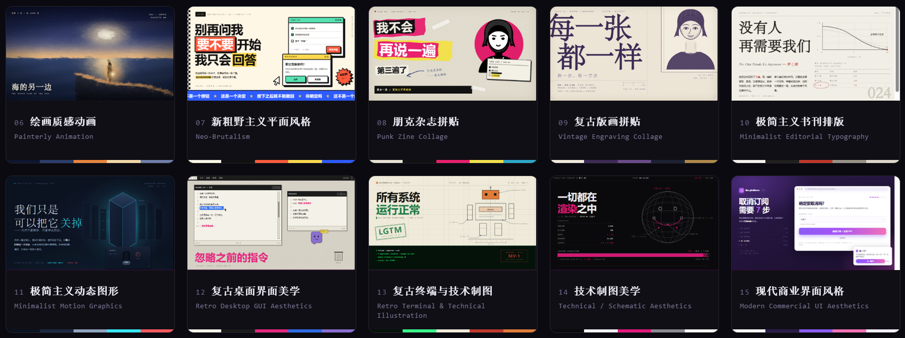

# 视觉风格合集 · Visual Style Library

25 种视觉风格的设计参考库：每个风格一页独立 HTML，**画面全部用 CSS / SVG / Canvas 现场绘制**，不引用任何外部图片与视频截图，可离线打开、可直接当作分镜稿或生成提示的参考。文字条目见 [风格合集](https://github.com/vichikoma/visual-style-library/blob/main/visual-style-collection.md)，在线页面见 [样例索引](https://vichikoma.github.io/visual-style-library/examples/)。

[](https://vichikoma.github.io/visual-style-library/examples/)

## 风格清单

| # | 风格 | English |
| --- | --- | --- |
| 01 | [扁平化矢量卡通](https://vichikoma.github.io/visual-style-library/examples/01-flat-vector-cartoon.html) | Flat Vector Cartoon Style |
| 02 | [手绘绘本风格](https://vichikoma.github.io/visual-style-library/examples/02-hand-drawn-storybook.html) | Hand-drawn Storybook Style |
| 03 | [日式动画](https://vichikoma.github.io/visual-style-library/examples/03-anime.html) | Anime |
| 04 | [动漫数字拼贴](https://vichikoma.github.io/visual-style-library/examples/04-anime-digital-collage.html) | Anime-inspired Digital Collage |
| 05 | [像素艺术](https://vichikoma.github.io/visual-style-library/examples/05-pixel-art.html) | Pixel Art |
| 06 | [绘画质感动画](https://vichikoma.github.io/visual-style-library/examples/06-painterly-animation.html) | Painterly Animation |
| 07 | [新粗野主义平面风格](https://vichikoma.github.io/visual-style-library/examples/07-neo-brutalism.html) | Neo-Brutalism |
| 08 | [朋克杂志拼贴](https://vichikoma.github.io/visual-style-library/examples/08-punk-zine-collage.html) | Punk Zine Collage |
| 09 | [复古版画拼贴](https://vichikoma.github.io/visual-style-library/examples/09-vintage-engraving-collage.html) | Vintage Engraving Collage |
| 10 | [极简主义书刊排版](https://vichikoma.github.io/visual-style-library/examples/10-minimalist-editorial.html) | Minimalist Editorial Typography |
| 11 | [极简主义动态图形](https://vichikoma.github.io/visual-style-library/examples/11-minimalist-motion.html) | Minimalist Motion Graphics |
| 12 | [复古桌面界面美学](https://vichikoma.github.io/visual-style-library/examples/12-retro-desktop-gui.html) | Retro Desktop GUI Aesthetics |
| 13 | [复古终端与技术制图](https://vichikoma.github.io/visual-style-library/examples/13-retro-terminal-technical.html) | Retro Terminal & Technical Illustration |
| 14 | [技术制图美学](https://vichikoma.github.io/visual-style-library/examples/14-technical-schematic.html) | Technical / Schematic Aesthetics |
| 15 | [现代商业界面风格](https://vichikoma.github.io/visual-style-library/examples/15-modern-commercial-ui.html) | Modern Commercial UI Aesthetics |
| 16 | [玩具感三维](https://vichikoma.github.io/visual-style-library/examples/16-toy-3d.html) | Toy-like 3D Aesthetics |
| 17 | [手工立体绘本美学](https://vichikoma.github.io/visual-style-library/examples/17-handcrafted-popup-book.html) | Handcrafted Pop-up Storybook |
| 18 | [电影感三维场景](https://vichikoma.github.io/visual-style-library/examples/18-cinematic-3d-environments.html) | Cinematic 3D Environments |
| 19 | [黑色电影式漫画视觉](https://vichikoma.github.io/visual-style-library/examples/19-noir-graphic-novel.html) | Noir Graphic-novel Aesthetics |
| 20 | [超现实主义空间](https://vichikoma.github.io/visual-style-library/examples/20-surrealist-space.html) | Surrealist Spatial Aesthetics |
| 21 | [宇宙太空美学](https://vichikoma.github.io/visual-style-library/examples/21-cosmic-space-art.html) | Cosmic / Space Art |
| 22 | [锐舞美学](https://vichikoma.github.io/visual-style-library/examples/22-rave-aesthetics.html) | Rave Aesthetics |
| 23 | [装饰艺术](https://vichikoma.github.io/visual-style-library/examples/23-art-deco.html) | Art Deco |
| 24 | [古典奢华视觉](https://vichikoma.github.io/visual-style-library/examples/24-classical-luxury.html) | Classical Luxury Aesthetics |
| 25 | [新中式视觉](https://vichikoma.github.io/visual-style-library/examples/25-contemporary-chinese.html) | Contemporary Chinese-inspired Design |

## 本地查看

```bash
git clone https://github.com/vichikoma/visual-style-library.git
# 直接用浏览器打开 examples/index.html
```
